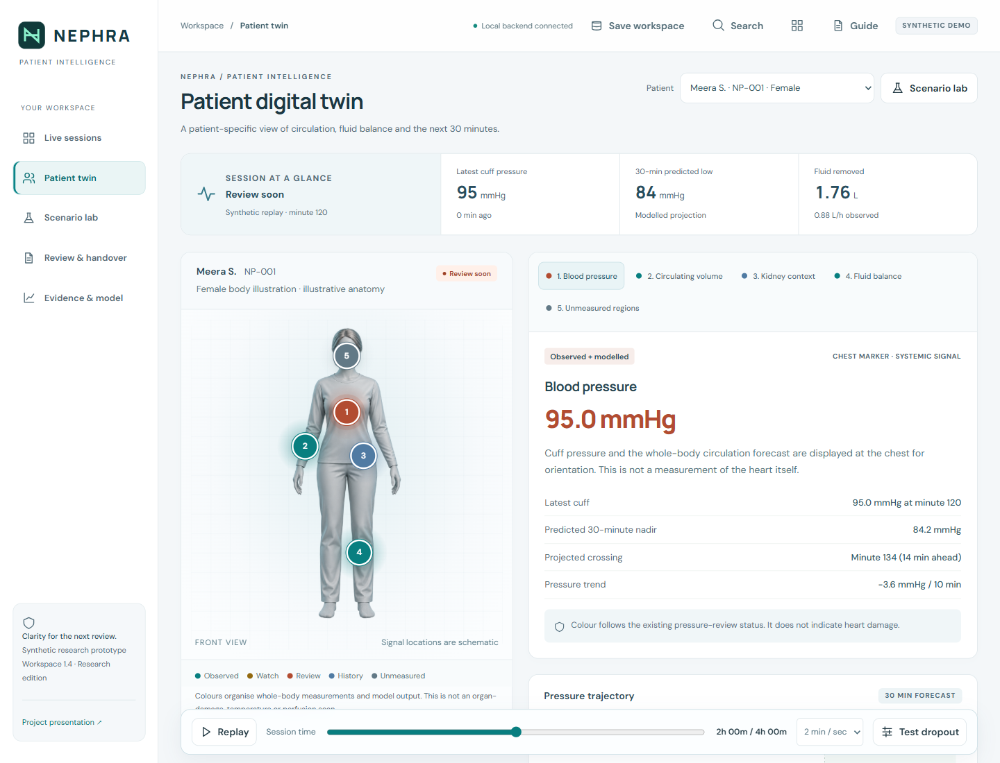
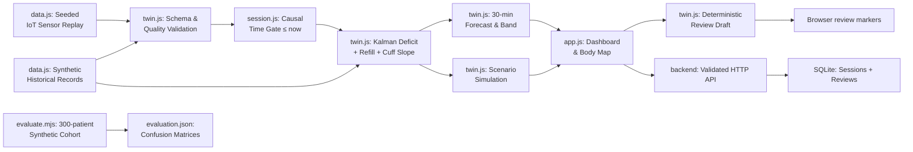
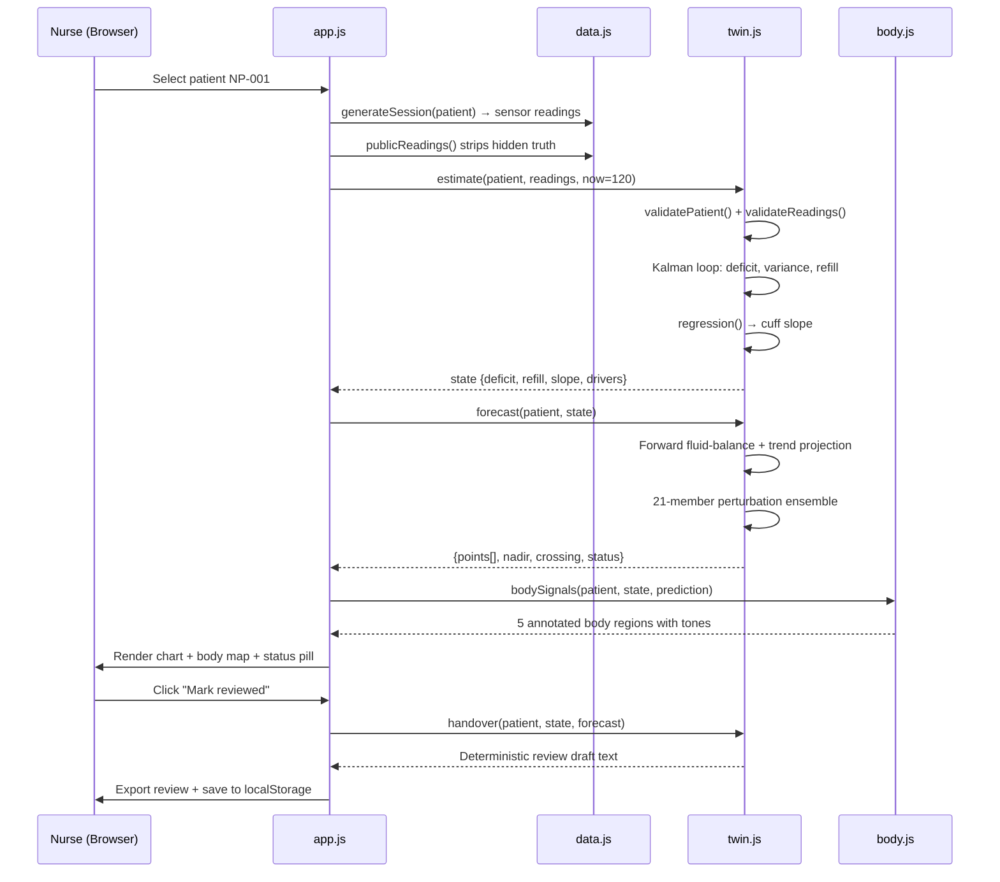

# Prototype & Code Submission

## 1. Team Details

**Team name:** Atreides

The responsibilities cover three complementary project aspects: technical leadership and modelling, product experience and application development, and validation and submission delivery.

| Team member | Project aspect | Role 1 | Role 2 | Role 3 |
|---|---|---|---|---|
| **Premnath V R** | Technical leadership and digital twin | **Team Leader** | Systems Architecture Lead | Digital Twin Modelling Lead |
| **Mirthika S** | Product experience and application development | UI/UX Design Lead | Frontend Development Lead | Interactive Body Visualisation Lead |
| **Dharshini T** | Validation and submission delivery | Software Quality Assurance Lead | Synthetic Data Evaluation Lead | Documentation and Demo Presentation Lead |

---

## 2. College/Incubator Information

**College:** Bannari Amman Institute of Technology

---

## 3. Project Title

**NEPHRA: A Patient-Specific Digital Twin for Dialysis Review**

A patient-specific digital twin that fuses synthetic historical records with simulated medical-IoT streams to forecast systolic blood pressure 30 minutes ahead during dialysis, show *why* the forecast changed, and let staff explore a what-if fluid-removal scenario — with a responsive browser workspace and a Node.js/SQLite backend for saving synthetic sessions and reviews. The public static demo also works independently of the backend.




---

## 4. Problem Statement

During haemodialysis, fluid is removed faster than the body can refill it, risking a drop in blood pressure. Nurses monitor intermittent cuff readings and UF settings across a multi-patient unit, but a single threshold alarm tells them nothing about the patient's *trajectory*. KDIGO identifies intradialytic systolic pressure below 90 mmHg as a serious complication warranting reassessment ([KDIGO conference report](https://kdigo.org/wp-content/uploads/2017/05/KDIGO-BP-Volume-in-Dialysis-FINAL.pdf)). Reviewing and transcribing observations for each patient adds repetitive preparation work that compounds across a 24-patient shift.

---

## 5. Healthcare Use Case

NEPHRA supports a research workflow for nurses and nephrologists reviewing maintenance haemodialysis sessions. It combines synthetic historical context and simulated sensor observations to project systolic blood pressure over the next 30 minutes, explain the model's drivers, compare hypothetical fluid-removal rates, and prepare a review draft for human verification. The prototype uses synthetic data and does not issue treatment or machine commands.

### Implemented Solution

- **30-minute pressure forecast** — a mechanistic state-space model (`nephra-state-space-1.1`) predicts systolic BP trajectory per patient with a sensitivity band and 21-member perturbation ensemble ([`twin.js → forecast()`](shared/engine/twin.js))
- **Scalar Kalman state estimation** — fuses relative-blood-volume sensors into a latent circulating-volume-deficit estimate in real time, gated by data-quality checks ([`twin.js → estimate()`](shared/engine/twin.js))
- **Scenario lab** — staff adjust a hypothetical UF rate and instantly see the pressure-vs-fluid-removed tradeoff from the same current state ([`app.js → scenarios()`](frontend/src/app.js))
- **Interactive body signal map** — sex-matched anatomical illustration with five annotated regions; each region discloses whether its data is observed, modelled, historical, or unavailable ([`body.js → bodySignals()`](shared/engine/body.js))
- **Automated review draft & export** — deterministic handover note assembled from observations and model output; downloadable as text with a local review log ([`twin.js → handover()`](shared/engine/twin.js))
- **Reproducible evaluation** — 300-patient synthetic cohort benchmarked against two baselines; confusion matrices and per-window CSV regenerable via `npm run evaluate` ([`evaluate.mjs`](scripts/evaluate.mjs))

---

## 6. Technical Stack

| Layer | Technology | Why |
|---|---|---|
| Interface | Semantic HTML, responsive CSS, vanilla JS ES modules, inline SVG charts | No production dependencies; responsive, keyboard-accessible workspace |
| Twin engine | Dependency-free JS numerical routines (`twin.js`, `data.js`) | Deterministic seeded generation; no ML framework needed for mechanistic model |
| Body visualisation | `body.js` + PNG anatomical assets | Accessible hover/focus/tap regions with provenance disclosure |
| Backend | Node.js ≥ 24.15, built-in HTTP and SQLite | Versioned migrations, isolated browser workspaces, validated API, atomic saves |
| Runtime & tests | `node:test`, `node:assert` | 44 model, workspace and backend checks; no test framework to install |
| Persistence | SQLite + browser fallback | Explicit Save workspace persists up to 20 imported sessions and 100 reviews; browser-only mode stores review markers locally |
| CI | GitHub Actions, Node 24 | Syntax checks, tests, reproducible evaluation and static build on every push ([`check.yml`](.github/workflows/check.yml)) |
| Docs (optional) | Python ReportLab + Poppler | Only for regenerating architecture/presentation PDFs |

---

## 7. AI/ML Model or Framework Details

**Model:** `nephra-state-space-1.1`, an adaptive mechanistic state-space model implemented in dependency-free JavaScript. A scalar Kalman filter updates the circulating-volume deficit using relative blood volume. The forecast combines fluid-balance modelling with recent cuff-pressure trends. No pretrained neural network or clinical training dataset is used. See the [model card](docs/model-card.md) for equations, assumptions, and validation limits.

### What Makes This Different

- **Mechanistic model, not a black box** — the forecast is a forward fluid-balance simulation fused with a Kalman-corrected deficit and a least-squares cuff slope, not a pretrained neural network. Every driver (pressure trend, deficit, refill rate, history) is displayed alongside the prediction ([`twin.js` L37–59](shared/engine/twin.js)).
- **Counterfactual scenario from the same state** — the scenario lab runs `forecast()` a second time with a different UF rate from the *identical* estimated state, so the tradeoff (pressure vs. fluid removed) is a direct comparison, not a separate model ([`twin.js` L61–81](shared/engine/twin.js)).
- **Principled data-quality gates** — the estimator *withholds* the forecast entirely when cuff readings are stale (>10 min), sensor quality is poor, or fewer than 3 good readings exist in the last 25 minutes, rather than producing a silently degraded output ([`twin.js` L43](shared/engine/twin.js)).
- **Provenance at every body region** — each of the five body-map regions explicitly labels its data as "Observed," "Modelled," "Historical context," or "Not measured," and states what is *not* inferred (e.g., "No organ damage … is inferred") ([`body.js` L10–36](shared/engine/body.js)).

---

## 8. Demo Video (15–20 Minutes, Unlisted YouTube)

**YouTube demo:** [Watch NEPHRA — Explainable Dialysis Digital Twin | Team Atreides](https://youtu.be/4h-k-ecFVXE)

The demo covers the patient digital twin, interactive body maps, scenario comparisons, data-quality safeguards, review preparation, evaluation results, and validation roadmap.

- [x] Demo video uploaded to YouTube and linked above.
- [ ] Confirm the YouTube video visibility is set to Unlisted.

---

## 9. Open-source License Details

[MIT License](LICENSE) — Copyright © 2026 NEPHRA contributors. See [THIRD_PARTY_NOTICES.md](THIRD_PARTY_NOTICES.md) for external references.

---

## 10. Architecture Diagram (PDF/PPT)

- [View the architecture diagram on Google Drive](https://drive.google.com/file/d/1VEXY88QO6mF9oiz2O2XGyVFF3enl0toK/view?usp=sharing)
- [Download the architecture diagram](https://drive.google.com/uc?export=download&id=1VEXY88QO6mF9oiz2O2XGyVFF3enl0toK)
- [Repository copy (PDF)](dist/docs/architecture.pdf)

**Access verification pending:** Confirm that the Drive file is shared as “Anyone with the link” with Viewer access and that downloading is enabled.

### Architecture Overview



> **Runtime boundary:** The browser computes live forecasts through the shared engine. `npm start` serves the UI and a real local API on `127.0.0.1:4173`; explicit saves send synthetic workspace snapshots to SQLite. The API also exposes the same forecast engine. The public Sites deployment is the standalone static edition and has no server persistence. See the [current full-stack architecture](docs/architecture.md) and [backend API guide](backend/README.md). The PDF above illustrates the earlier browser-only edition.

### End-to-End Forecast Flow



---

## 11. Presentation Covering Project Details and Outcomes (PDF/PPT)

[Download the project presentation (PDF)](dist/docs/presentation.pdf).

The presentation covers the problem, healthcare use case, technical approach, prototype, synthetic evaluation outcomes, limitations, and next steps. This PDF reflects an earlier visual release. Replace it with the team’s final presentation when ready.

---

## 12. Public Accessibility of All Files and Links

The final GitHub repository, document links, and unlisted YouTube video must open without additional permissions.

**Verification status:** Pending for the final submission.

- [ ] The final GitHub repository is public.
- [ ] All README file links open while signed out.
- [ ] The YouTube demo opens while signed out without an access request.
- [ ] The final architecture diagram and presentation open without additional permissions.

---

<details>
<summary><strong>Additional Project Documentation</strong></summary>

### Quickstart

**Prerequisites:** Node.js **24.15 or newer**. No API key or dependency installation is required.

```bash
npm start          # Frontend + backend at http://127.0.0.1:4173
npm run dev        # Same app, restart backend when source changes
npm run check      # Syntax validation and all 44 tests
npm run evaluate   # Reproduce the 300-patient synthetic benchmark
npm run build      # Create the public static edition in dist/
npm run serve:dist # Preview dist/ at http://127.0.0.1:4173
```

Use one server command at a time on the default port. Set `PORT` to choose another port. In full-stack mode, use **Save workspace** to persist imported synthetic sessions and review markers. Data survives server restart; the same browser cookie reconnects to its saved workspace. Clearing the cookie loses access to that workspace. The server binds only to the local computer. Do not double-click `index.html`; ES modules require HTTP.

### Project Structure

```text
frontend/                    Browser application
  index.html                 Entry point and content security policy
  src/
    app.js                   Application orchestration and event binding
    core/                    State, routing, constants, icons
    views/                   Unit, twin, scenarios, handover, evidence
    components/              Charts, body map, dialogs, patient controls
    services/api.js          Backend connection and explicit workspace save
    styles/                  Base, component and refined workspace styles
    utils/                   Formatting and browser helpers
  public/                    Anatomical assets, benchmark, PDFs, model card
backend/                     Local research API
  src/server.js              Server startup and graceful shutdown
  src/app.js                 HTTP routing, security boundaries, static serving
  src/service.js             Input validation and authoritative forecasts
  src/repository.js          SQLite transactions and workspace persistence
  migrations/               Versioned database schema
  tests/                     HTTP integration and persistence tests
  data/                      Local runtime database (ignored by Git)
shared/engine/               One model used by browser, API and tests
  twin.js                    Estimation, forecast, sensitivity, review draft
  data.js                    Seeded synthetic cohort and observations
  session.js                 Import validation and replay bounds
  body.js                    Body-region signals and provenance
  workspace.js               Queue, routing, review and benchmark validation
scripts/                     Build, checks, evaluation, static preview, PDFs
tests/                       Model, body, import and workspace regression tests
docs/                        Model card, methods, architecture, QA and roadmap
dist/                        Generated static deployment; never edit directly
.github/workflows/           Continuous verification
```

Read the [frontend guide](frontend/README.md), [backend guide](backend/README.md), [architecture](docs/architecture.md), and [QA report](docs/qa-report.md).

### Challenges & What We Learned

- **Generator–model entanglement** — the synthetic observation generator and the estimator share broad fluid-balance assumptions, so the evaluation benchmark is same-family, not independent. We document this explicitly in `evaluation.json` and the model card rather than treating synthetic recall as clinical evidence.
- **Kalman tuning without real data** — with no actual patient sessions, the process-noise and measurement-noise parameters (`0.00015`, `0.0025` in `twin.js`) were chosen to produce stable tracking on synthetic streams. A clinical pilot would need to fit these from retrospective dialysis records.
- **Sensitivity ≠ probability** — the 21-member perturbation ensemble and the heuristic band width are model-sensitivity summaries, not calibrated confidence intervals. Communicating this distinction clearly in the UI (every tooltip says "not a calibrated confidence interval") was as important as computing it.

<!-- TODO: fill in from the team's actual experience -->

### What’s Next

- **Retrospective validation on de-identified dialysis records** — fit patient-specific priors from real historical sessions instead of synthetic parameters
- **Adaptive noise tuning** — learn Kalman process/measurement noise per patient from retrospective session data to replace hard-coded constants
- **Multi-session trend tracking** — carry forward refill-rate and sensitivity estimates across sessions to detect slow patient deterioration
- **Standards-based integration** — FHIR-compatible observation input and HL7 alert output for hospital EHR connectivity
- **Silent clinical pilot** — run the model shadow-mode alongside standard monitoring, measure time-to-review and false-alert rate before any assisted workflow

### Workspace 1.4 — Full-Stack Research Edition

The refined light workspace includes a priority review queue, patient/page search, male/female body maps, contextual review navigation, scenario comparisons, and explicit evidence limits. The backend adds validated synthetic workspace saves, SQLite persistence, conflict detection, and forecast endpoints. `npm run check` runs **44 tests**. See [product readiness](docs/product-readiness.md) for remaining deployment and clinical-validation work. No measured 90% workload reduction or clinical effectiveness is claimed.

</details>
