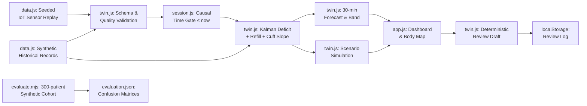
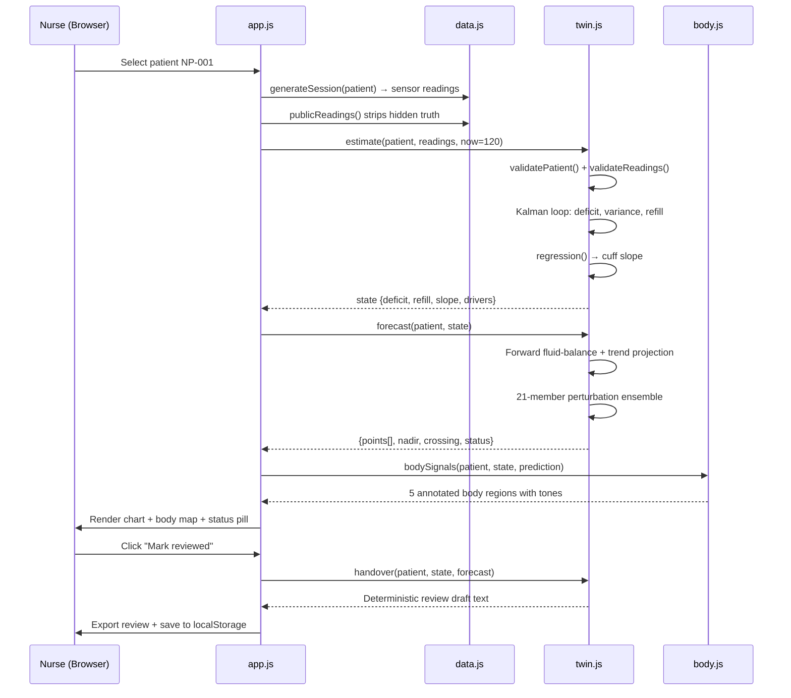

# Prototype & Code Submission

## 1. Team Details

**Team name:** Atreides

The responsibilities cover three complementary project aspects: technical leadership and modelling, product experience and application development, and validation and submission delivery.

| Team member | Project aspect | Role 1 | Role 2 | Role 3 |
|---|---|---|---|---|
| **Premnath V R** | Technical leadership and digital twin | **Team Leader** | Systems Architecture Lead | Digital Twin Modelling Lead |
| **Mirthika S** | Product experience and application development | UI/UX Design Lead | Frontend Development Lead | Interactive Body Visualisation Lead |
| **Dharshini T** | Validation and submission delivery | Software Quality Assurance Lead | Synthetic Data Evaluation Lead | Documentation and Demo Presentation Lead |

---

## 2. College/Incubator Information

**College:** Bannari Amman Institute of Technology

---

## 3. Project Title

**NEPHRA: A Patient-Specific Digital Twin for Dialysis Review**

A patient-specific digital twin that fuses synthetic historical records with simulated medical-IoT streams to forecast systolic blood pressure 30 minutes ahead during dialysis, show *why* the forecast changed, and let staff explore a what-if fluid-removal scenario — all running in the browser with zero backend.


<!-- TODO: screenshot or 60s demo GIF here -->

---

## 4. Problem Statement

During haemodialysis, fluid is removed faster than the body can refill it, risking a drop in blood pressure. Nurses monitor intermittent cuff readings and UF settings across a multi-patient unit, but a single threshold alarm tells them nothing about the patient's *trajectory*. KDIGO identifies intradialytic systolic pressure below 90 mmHg as a serious complication warranting reassessment ([KDIGO conference report](https://kdigo.org/wp-content/uploads/2017/05/KDIGO-BP-Volume-in-Dialysis-FINAL.pdf)). Reviewing and transcribing observations for each patient adds repetitive preparation work that compounds across a 24-patient shift.

---

## 5. Healthcare Use Case

NEPHRA supports a research workflow for nurses and nephrologists reviewing maintenance haemodialysis sessions. It combines synthetic historical context and simulated sensor observations to project systolic blood pressure over the next 30 minutes, explain the model's drivers, compare hypothetical fluid-removal rates, and prepare a review draft for human verification. The prototype uses synthetic data and does not issue treatment or machine commands.

### Implemented Solution

- **30-minute pressure forecast** — a mechanistic state-space model (`nephra-state-space-1.1`) predicts systolic BP trajectory per patient with a sensitivity band and 21-member perturbation ensemble ([`twin.js → forecast()`](dist/lib/twin.js))
- **Scalar Kalman state estimation** — fuses relative-blood-volume sensors into a latent circulating-volume-deficit estimate in real time, gated by data-quality checks ([`twin.js → estimate()`](dist/lib/twin.js))
- **Scenario lab** — staff adjust a hypothetical UF rate and instantly see the pressure-vs-fluid-removed tradeoff from the same current state ([`app.js → scenarios()`](dist/app.js))
- **Interactive body signal map** — sex-matched anatomical illustration with five annotated regions; each region discloses whether its data is observed, modelled, historical, or unavailable ([`body.js → bodySignals()`](dist/lib/body.js))
- **Automated review draft & export** — deterministic handover note assembled from observations and model output; downloadable as text with a local review log ([`twin.js → handover()`](dist/lib/twin.js))
- **Reproducible evaluation** — 300-patient synthetic cohort benchmarked against two baselines; confusion matrices and per-window CSV regenerable via `npm run evaluate` ([`evaluate.mjs`](scripts/evaluate.mjs))

---

## 6. Technical Stack

| Layer | Technology | Why |
|---|---|---|
| Interface | Semantic HTML, responsive CSS, vanilla JS ES modules, inline SVG charts | Zero dependencies; runs offline after first load |
| Twin engine | Dependency-free JS numerical routines (`twin.js`, `data.js`) | Deterministic seeded generation; no ML framework needed for mechanistic model |
| Body visualisation | `body.js` + PNG anatomical assets | Accessible hover/focus/tap regions with provenance disclosure |
| Runtime & tests | Node.js ≥ 20, `node:test`, `node:assert` | No test framework to install; `npm test` runs 17 behavioural checks |
| Persistence | Browser `localStorage` | Capped at 100 review entries; no server-side state |
| CI | GitHub Actions, Node 22 | Syntax check + test + reproducible evaluation on every push ([`check.yml`](.github/workflows/check.yml)) |
| Docs (optional) | Python ReportLab + Poppler | Only for regenerating architecture/presentation PDFs |

---

## 7. AI/ML Model or Framework Details

**Model:** `nephra-state-space-1.1`, an adaptive mechanistic state-space model implemented in dependency-free JavaScript. A scalar Kalman filter updates the circulating-volume deficit using relative blood volume. The forecast combines fluid-balance modelling with recent cuff-pressure trends. No pretrained neural network or clinical training dataset is used. See the [model card](docs/model-card.md) for equations, assumptions, and validation limits.

### What Makes This Different

- **Mechanistic model, not a black box** — the forecast is a forward fluid-balance simulation fused with a Kalman-corrected deficit and a least-squares cuff slope, not a pretrained neural network. Every driver (pressure trend, deficit, refill rate, history) is displayed alongside the prediction ([`twin.js` L37–59](dist/lib/twin.js)).
- **Counterfactual scenario from the same state** — the scenario lab runs `forecast()` a second time with a different UF rate from the *identical* estimated state, so the tradeoff (pressure vs. fluid removed) is a direct comparison, not a separate model ([`twin.js` L61–81](dist/lib/twin.js)).
- **Principled data-quality gates** — the estimator *withholds* the forecast entirely when cuff readings are stale (>10 min), sensor quality is poor, or fewer than 3 good readings exist in the last 25 minutes, rather than producing a silently degraded output ([`twin.js` L43](dist/lib/twin.js)).
- **Provenance at every body region** — each of the five body-map regions explicitly labels its data as "Observed," "Modelled," "Historical context," or "Not measured," and states what is *not* inferred (e.g., "No organ damage … is inferred") ([`body.js` L10–36](dist/lib/body.js)).

---

## 8. Demo Video (15–20 Minutes, Unlisted YouTube)

**Unlisted YouTube link:** TODO — upload the final 15–20 minute demo and add its URL here.

[Download the existing 20-minute walkthrough](output/NEPHRA-20-minute-demo.mp4). This local deliverable does not complete the YouTube requirement. It reflects an earlier visual release and can be replaced with the team’s final recording.

- [ ] Final video uploaded as Unlisted on YouTube and linked above.

---

## 9. Open-source License Details

[MIT License](LICENSE) — Copyright © 2026 NEPHRA contributors. See [THIRD_PARTY_NOTICES.md](THIRD_PARTY_NOTICES.md) for external references.

---

## 10. Architecture Diagram (PDF/PPT)

[Download the architecture diagram (PDF)](dist/docs/architecture.pdf).

### Architecture Overview



> **Runtime boundary:** All computation executes in the browser. The Node server ([`serve.mjs`](scripts/serve.mjs)) only serves static files on `127.0.0.1:4173`. No API keys, no cloud model calls, no data upload.

### End-to-End Forecast Flow



---

## 11. Presentation Covering Project Details and Outcomes (PDF/PPT)

[Download the project presentation (PDF)](dist/docs/presentation.pdf).

The presentation covers the problem, healthcare use case, technical approach, prototype, synthetic evaluation outcomes, limitations, and next steps. This PDF reflects an earlier visual release. Replace it with the team’s final presentation when ready.

---

## 12. Public Accessibility of All Files and Links

The final GitHub repository, document links, and unlisted YouTube video must open without additional permissions.

**Verification status:** Pending for the final submission.

- [ ] The final GitHub repository is public.
- [ ] All README file links open while signed out.
- [ ] The YouTube demo opens while signed out without an access request.
- [ ] The final architecture diagram and presentation open without additional permissions.

---

<details>
<summary><strong>Additional Project Documentation</strong></summary>

### Quickstart

**Prerequisites:** Node.js 20+. No API key, `npm install`, or external service needed.

```bash
# Start the local server
npm start
# → http://127.0.0.1:4173

# Run 17 behavioural tests
npm test

# Regenerate the 300-patient evaluation
npm run evaluate

# Syntax check + tests + evaluation in one shot
npm run check
```

Open `http://127.0.0.1:4173` in any modern browser. Do **not** double-click `index.html` — JS modules require an HTTP server.

<details>
<summary><strong>Project Structure</strong></summary>

```text
dist/                        Deployable static application
  index.html                 Single-page entry point
  app.js                     Dashboard, views, replay controls, event binding
  style.css                  Responsive CSS with dark sidebar
  lib/
    twin.js                  Validation, Kalman estimation, forecast, handover
    data.js                  Seeded synthetic patient cohort + session generator
    session.js               Import parsing, replay bounds, HTML escaping
    body.js                  Anatomical body-signal projection (5 regions)
  assets/
    body-female.png           Female anatomical illustration
    body-male.png             Male anatomical illustration
  data/
    evaluation.json           Machine-readable benchmark metrics
  docs/
    architecture.pdf          Architecture diagram (PDF)
    presentation.pdf          Project presentation (PDF)
    model-card.md             Model card
docs/                        Methods, validation, pilot plan, demo script
  architecture.md            Mermaid source for architecture diagram
  model-card.md              Model limitations and intended use
  data-dictionary.md         Synthetic data schema
  validation.md              Evaluation protocol and known limitations
  pilot-and-business-case.md Prospective pilot measurement plan
  evaluation-windows.csv     Per-window prediction CSV (1,193 rows)
  screenshots/               Dashboard, body map, scenario, workflow captures
scripts/
  serve.mjs                  Zero-dependency static file server (loopback)
  evaluate.mjs               300-patient cohort evaluation pipeline
  build-docs.py              PDF generation (ReportLab; optional)
tests/
  twin.test.mjs              17 behavioural model tests (causal, bounds, quality)
  session.test.mjs           Import parsing and replay tests
  body.test.mjs              Body signal projection tests
.github/workflows/
  check.yml                  CI: syntax + tests + reproducible evaluation
```

</details>

### Challenges & What We Learned

- **Generator–model entanglement** — the synthetic observation generator and the estimator share broad fluid-balance assumptions, so the evaluation benchmark is same-family, not independent. We document this explicitly in `evaluation.json` and the model card rather than treating synthetic recall as clinical evidence.
- **Kalman tuning without real data** — with no actual patient sessions, the process-noise and measurement-noise parameters (`0.00015`, `0.0025` in `twin.js`) were chosen to produce stable tracking on synthetic streams. A clinical pilot would need to fit these from retrospective dialysis records.
- **Sensitivity ≠ probability** — the 21-member perturbation ensemble and the heuristic band width are model-sensitivity summaries, not calibrated confidence intervals. Communicating this distinction clearly in the UI (every tooltip says "not a calibrated confidence interval") was as important as computing it.

<!-- TODO: fill in from the team's actual experience -->

### What’s Next

- **Retrospective validation on de-identified dialysis records** — fit patient-specific priors from real historical sessions instead of synthetic parameters
- **Adaptive noise tuning** — learn Kalman process/measurement noise per patient from retrospective session data to replace hard-coded constants
- **Multi-session trend tracking** — carry forward refill-rate and sensitivity estimates across sessions to detect slow patient deterioration
- **Standards-based integration** — FHIR-compatible observation input and HL7 alert output for hospital EHR connectivity
- **Silent clinical pilot** — run the model shadow-mode alongside standard monitoring, measure time-to-review and false-alert rate before any assisted workflow

### Workspace 1.2 — Interface and Reliability Update

The refined workspace includes patient/page search (Ctrl or Command K), focus mode, an attention queue, accessible forecast values, scenario shortcuts, review undo, copy/print/export, and recoverable loading/error states. Run `npm run check` for the current **30 checks**. See [product readiness and validation](docs/product-readiness.md) for shipped capabilities and the remaining requirements before clinical use. This is a deployable synthetic research product, not a clinically validated system.

</details>
