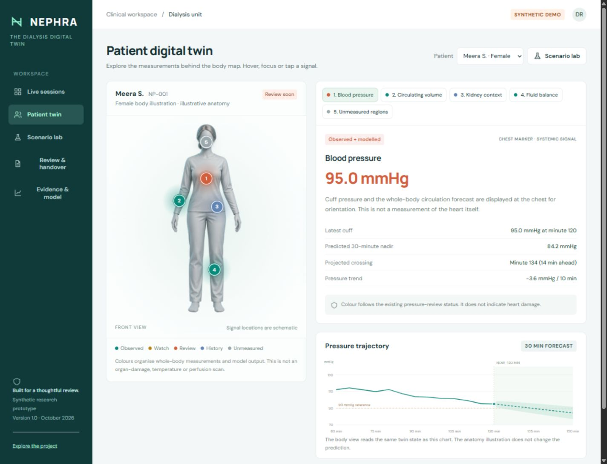

# NEPHRA
### A patient-specific digital twin for anticipating blood-pressure falls during dialysis

**Happiest Health Digital Twin Challenge 2026 | Synthetic research proof of concept**

[Open the hosted prototype](https://nephra-dialysis-twin.dainty-shark-5340.chatgpt.site)

NEPHRA combines a synthetic historical record with a changing medical-IoT stream to forecast systolic blood pressure over the next 30 minutes. Staff can inspect why the forecast changed, explore a hypothetical fluid-removal scenario, and export a review draft without retyping the observations.



> This prototype is not clinically validated. It uses only synthetic patients. It cannot diagnose, prescribe, control a machine, or substitute for clinical monitoring. The 90% figure is a target for repetitive preparation time under explicit assumptions, not measured total workload reduction.

## Team details

**To be completed by the submitting team.**

| Field | Value |
|---|---|
| Team name | TODO: registered team name |
| Team leader | TODO: full name and role |
| Member 2 | TODO: full name and role, or remove |
| Member 3 | TODO: full name and role, or remove |
| Member 4 | TODO: full name and role, or remove |
| Public GitHub repository | TODO: public repository URL |

## College / incubator information

| Field | Value |
|---|---|
| College / institute | TODO: full official name |
| Department and programme | TODO |
| Incubator and mentor, if applicable | TODO, or explicitly state not applicable |

Provide the team leader's phone and email in the submission portal. Publish personal contact information in this repository only if the team chooses to.

## Project title

**NEPHRA: An explainable dialysis digital twin for 30-minute hypotension forecasting and assisted clinical review.**

## Problem statement

During haemodialysis, removing fluid faster than the circulation can refill can contribute to a fall in blood pressure. Staff must interpret intermittent cuff readings alongside fluid-removal settings, trends and patient history. A current-value threshold does not describe the patient's future trajectory; reviewing and transcribing multiple observations adds repetitive work.

**Our narrow question:** can a patient-specific, continuously updated model flag a future systolic-pressure crossing below 90 mmHg within 30 minutes, while showing uncertainty and the fluid-removal tradeoff of a hypothetical scenario?

KDIGO describes intradialytic hypotension as a serious complication and recommends reassessment for symptomatic falls or an intradialytic systolic nadir below 90 mmHg. The threshold alone is only one definition; NEPHRA does not model symptoms or claim to capture every hypotensive event. [KDIGO conference report](https://kdigo.org/wp-content/uploads/2017/05/KDIGO-BP-Volume-in-Dialysis-FINAL.pdf).

## Healthcare use case

- **Condition:** advanced chronic kidney disease requiring maintenance haemodialysis.
- **User:** dialysis nurse or nephrologist reviewing a multi-patient unit.
- **Outcome:** future low systolic blood pressure within a 30-minute window.
- **Historical stream:** synthetic dry weight, baseline pressure, refill prior, pressure sensitivity, comorbidities and prior episode history.
- **Dynamic stream:** simulated cuff pressure every five minutes; relative blood volume, pulse and ultrafiltration observations every minute.
- **Workflow:** select a patient, replay observations, inspect the forecast, compare a scenario, review the draft, export the handover.
- **Decisions:** remain with qualified clinicians; no device control or autonomous treatment.

## What is implemented

| Capability | Implementation |
|---|---|
| Six personalised digital twins | Separate synthetic records, parameters and seeded sensor streams |
| Interactive male / female body heatmap | Patient-matched illustration; hover, focus or tap reveals values, provenance and limits |
| Online data fusion | Causal replay, scalar Kalman state correction, online refill estimate and recent pressure trend |
| Localised outcome prediction | 30-minute pressure trajectory, reference crossing, sensitivity band and review status |
| Scenario lab | Change hypothetical UF rate; compare pressure and fluid removed from the same current state |
| Data-quality handling | Withhold forecast for stale cuff readings, stale streams or insufficient reliable readings |
| Explainability | Pressure slope, estimated circulating-volume deficit, refill estimate and historical context |
| Review automation | Deterministic draft from observed values and model output; exportable local review log |
| Data portability | Validated synthetic JSON import and downloadable sample; processed locally |
| Evaluation | Reproducible patient-seeded cohort, simple baselines, confusion matrices and per-window CSV |
| Submission pack | Architecture PDF, presentation PDF, model card, data dictionary and demo material |

Pulse is displayed as context and is **not** an input to the pressure forecast. Prior episode count is also context only. Physiological priors are supplied synthetic parameters, not learned from actual historical dialysis sessions.

## Run locally

Prerequisite: **Node.js 20 or later**. No API key, package install or paid service is needed.

```sh
npm start
```

Open **http://127.0.0.1:4173**. Do not double-click `index.html`: JavaScript modules require an HTTP server. Google Fonts is an optional appearance request; the application uses system fonts if it is unavailable.

```sh
npm test
npm run evaluate
npm run check
```

The local server binds to loopback only. A hosted static deployment runs the same browser computation. There is no hosted patient database.

## Technical stack

| Layer | Technology |
|---|---|
| Interface | Semantic HTML, responsive CSS, vanilla JavaScript ES modules, SVG data charts |
| Twin and synthetic sensors | Dependency-free JavaScript numerical routines, deterministic seeded generation |
| Runtime / tests | Node.js standard library and `node:test` |
| Persistence | Browser localStorage for synthetic review markers only, capped at 100 entries |
| Hosting | Static files; Sites manifest included; GitHub Pages-compatible assets |
| Documentation generation | Python ReportLab and Poppler; only needed to regenerate PDFs |
| CI | GitHub Actions, Node 22, model checks and reproducible evaluation |

## AI / ML model and framework details

**Model:** `nephra-state-space-1.0`, a mechanistic model with adaptive state estimation. It is deliberately not described as a trained neural network.

1. Historical priors initialise circulating-volume size, refill rate and pressure sensitivity.
2. A scalar Kalman filter assimilates relative-blood-volume measurements into a latent volume-deficit estimate.
3. Recent sensor changes provide an online refill estimate; recent cuff readings provide a least-squares pressure slope.
4. A forward fluid-balance simulation and pressure-trend correction produce a personalised projection.
5. A heuristic sensitivity band and a deterministic 21-member perturbation ensemble describe model sensitivity. Neither is calibrated clinical uncertainty or a clinical probability.

The model only sees observations at or before replay time. No future truth is passed into the estimator. The synthetic generator includes different refill dynamics, parameter heterogeneity, correlated noise and a reserve-fatigue term, but shares broad physiological assumptions with the model. See [model card](docs/model-card.md) and [data dictionary](docs/data-dictionary.md).

## Results and reproducibility

Engineering benchmark: **300 synthetic patients, 1,193 eligible forecast windows, 128 future low-pressure windows**, seed `73021`. Each patient has one generated session. Windows already below the endpoint at forecast time are excluded. Repeated windows within a patient are correlated.

| Method | Nadir MAE (mmHg) | Event recall | False-positive windows |
|---|---:|---:|---:|
| Personalised twin | 2.25 | 86.7% (111/128) | 2 |
| Recent linear trend | 2.58 | 82.8% (106/128) | 7 |
| Last cuff carried forward | 6.47 | 0% (0/128) | 0 |

The twin misses **17 of 128** synthetic event windows. Persistence is intentionally simple and is structurally weak for predicting a future threshold crossing in a currently non-low cohort. The trend baseline is the more informative comparison. These results do not justify use on patients.

The benchmark cohort is separate from the six demo patients; it is **not a blinded external test set**. It was used for engineering inspection. No clinical records, model-training cohort or external validation cohort are included. There are no accuracy, clinical-benefit, regulatory-clearance or funding claims.

See [machine-readable metrics](dist/data/evaluation.json), [per-window predictions](docs/evaluation-windows.csv) and [validation record](docs/validation.md). Run `npm run evaluate` to regenerate metrics. Seventeen automated checks cover causal isolation, data quality, personalisation, scenario invariants and input rejection.

## The 90% workload target

The calculator defaults to **24 patients x 8 review cycles x 90 seconds manual preparation** versus **9 seconds assisted preparation**. That is 288 versus 28.8 minutes per day, or a modelled **90% reduction in preparation time**.

These are editable assumptions, not observed results. Bedside care, clinical judgement, treatment, validation, exception handling and implementation effort are excluded. [Pilot plan](docs/pilot-and-business-case.md) defines how to measure time savings and error rates honestly.

## Demo video

[Download the completed 20-minute narrated walkthrough](output/NEPHRA-20-minute-demo.mp4). It contains the project presentation and actual prototype captures with synthetic narration.

**Unlisted YouTube URL: TODO - upload the completed walkthrough and insert its link here.**

The submission form requests a 15-20 minute unlisted video; the public challenge listing says a minimum of 20 minutes. Target **20 minutes** and verify the final requirements in your portal. See [demo script and recording guide](docs/demo-script.md). A local video, when included in the delivery folder, is not a substitute for adding the unlisted YouTube URL here.

## Architecture diagram (PDF)

[Download the architecture diagram](dist/docs/architecture.pdf). It separates implemented local components from future clinical integrations. An editable textual version is included in [architecture.md](docs/architecture.md).

## Project presentation (PDF)

[Download the project presentation](dist/docs/presentation.pdf), covering the problem, use case, implementation, outcomes, evidence limits and pilot roadmap.

## Open-source license details

Original source and original documentation are released under the [MIT License](LICENSE). Synthetic records are generated by the included code and contain no real patient data. External references and optional Google Fonts retain their own terms; no third-party paper is redistributed. See [third-party notices](THIRD_PARTY_NOTICES.md).

## Public accessibility and final submission

The required GitHub repository and unlisted YouTube link must be reachable without extra permissions. **This is not yet verified for your final repository or video.**

- [ ] Team details filled in by team
- [ ] College / incubator information filled in by team
- [x] Project title
- [x] Problem statement
- [x] Healthcare use case
- [x] Technical stack
- [x] AI / ML model or framework details
- [ ] 20-minute unlisted YouTube video URL added and checked
- [x] Open-source license details
- [x] Architecture PDF linked above
- [x] Presentation PDF linked above
- [ ] Final GitHub repository is public; every document and video link tested while signed out

Use the required submission folder name **`Team Name_College Name`** after filling in those details. Follow [submission checklist](docs/submission-checklist.md); do not tick incomplete items.

## Repository map

```text
dist/                    Deployable application, shared model and demo data
  lib/data.js            Seeded synthetic cohort and observation generator
  lib/twin.js            Validation, state estimation, forecasts, review drafts
  app.js                 Dashboard and interactions
  docs/                  Public PDF resources and model card
docs/                    Methods, pilot plan, script, diagrams, raw results
scripts/                 Local server, evaluation and documentation builders
tests/                   Behavioural model tests
.github/workflows/       Reproducible checks
```

## References and existing work

1. [KDIGO: Blood pressure and volume management in dialysis](https://kdigo.org/wp-content/uploads/2017/05/KDIGO-BP-Volume-in-Dialysis-FINAL.pdf), 2020.
2. [Real-time prediction of intradialytic hypotension using machine learning and cloud computing infrastructure](https://pmc.ncbi.nlm.nih.gov/articles/PMC10310501/), 2023. Demonstrates that prediction itself is prior art.
3. [Dynamics of plasma refill rate and intradialytic hypotension](https://pmc.ncbi.nlm.nih.gov/articles/PMC10278774/), 2023. Supports investigating time-varying refill behaviour; does not validate our equations or coefficients.
4. [Happiest Health Digital Twin Challenge 2026](https://unstop.com/hackathons/crp-digital-twin-challenge-2026-happiest-health-1757873/amp). Requirements checked 7 October 2026; confirm portal wording before submission.

NEPHRA's proposed distinction is the combination of inspectable state updates, patient-specific counterfactuals with visible tradeoffs, failure handling and review preparation. It is not claimed to be the first dialysis predictor or a patentable invention.


