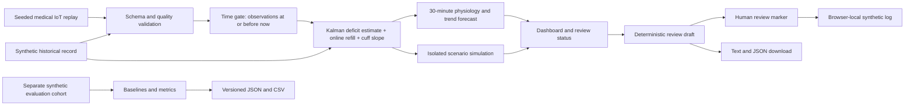

# Architecture

## Runtime boundary
All estimator, simulator and UI code executes in the browser. The Node local server only serves static files and does not receive patient streams. The hosted Site serves the same assets. Imported data stays in memory. Only synthetic review markers persist in localStorage. There are no API keys, model APIs, clinical data uploads or hospital connections.

## Reliability boundary
Schema validation precedes estimation. Temporal filtering precedes state updates. Quality gates suppress outputs on stale or insufficient observations. Counterfactuals never mutate the observed stream. The audit-like log is explicitly a local demo history, not an authenticated or tamper-proof audit service.

## Body view
`dist/lib/body.js` maps the existing twin state to labelled interactive body regions. The image is selected from the synthetic record; sex selects presentation only, not model behaviour. Every marker includes a data-source category and a limitation. There are no regional measurements, spatial risk estimates or organ-damage scores. The view is accessible by pointer hover, keyboard focus and tap.

## Future clinical integration (not implemented)
Device adapters, historical-session parameter fitting, standards-based hospital APIs, authenticated clinicians, encrypted clinical storage, consent controls, operational alert delivery, validated monitoring, regulatory review and a prospective clinical pilot are separate work. No automatic treatment path is proposed in this prototype.
