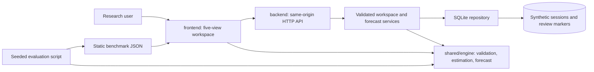

# NEPHRA 1.4 architecture

The project separates presentation, HTTP services, persistence and a shared physiological model. The frontend and backend call the same engine to avoid diverging forecast calculations.

## Full-stack mode

`npm start` serves frontend source, public assets and shared modules alongside `/api` on loopback. A workspace cookie selects isolated saved data. Startup loads saved synthetic imports and reviews; **Save workspace** validates and commits a snapshot atomically. Revision checks reject stale writes. Live replay runs in the browser; `/api/forecast` provides the equivalent server-side computation. Review markers are research workflow events, not signed clinical records.

## Public static mode

`npm run build` copies frontend assets, source and the shared engine into `dist/`. Sites publishes this directory. Backend source and SQLite are excluded. In this edition imported sessions remain in memory, review markers use browser storage, and no backend-save action is offered. It is a self-contained synthetic demonstration, not a hosted clinical service.

## Model flow

Synthetic historical parameters and observations pass schema and time validation. Kalman deficit estimation, refill estimation and cuff slope feed the 30-minute pressure projection. A 21-member perturbation ensemble describes sensitivity, not calibrated probability. Missing or poor observations withhold forecasts. The body map distinguishes observed, modelled, historical and unmeasured signals. Scenario simulation uses the same current state with a hypothetical UF rate.

The supplied architecture PDF documents the earlier static edition. This file is the current source of truth for the full-stack architecture.
